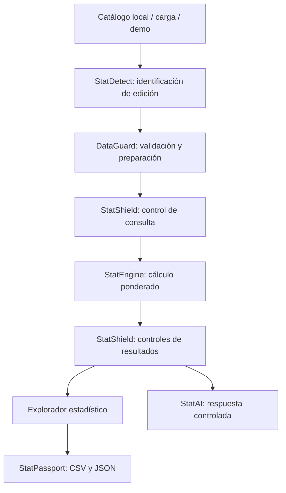

# StatCore GT

**De los datos abiertos a la evidencia confiable.**

Datatón INE 2026 · Equipo **ONU-AMIGOS** · Guatemala  
Categoría 2: Tecnológica y ciencias de datos

[](https://www.python.org/)
[](https://streamlit.io/)
[](#validación)

**Aplicación en línea:** [Abrir StatCore GT](https://dataton2026-onu-amigos.streamlit.app/)

## 1. ¿Qué es StatCore GT?

StatCore GT es una plataforma modular de inteligencia estadística, funcional y extensible, diseñada para automatizar el procesamiento, validación, análisis y divulgación responsable de los datos abiertos del Instituto Nacional de Estadística (INE) de Guatemala. Se presenta como un producto mínimo viable (MVP) que permite realizar análisis descriptivos reales dentro de su alcance y constituye una base para una futura adopción institucional. Integra detección de ediciones, validación de datos, cálculo ponderado, controles estadísticos, visualización interactiva, consultas en español y exportación de resultados con trazabilidad.

**Caso de aplicación:** brechas de género y autonomía económica en Guatemala, a partir de la Encuesta Nacional de Empleo e Ingresos Continua (ENEIC).

### Problema y propuesta de valor

Consultar microdatos requiere conocimientos técnicos y metodológicos que no todos los ciudadanos poseen. StatCore GT reduce esa barrera y automatiza tareas repetitivas sin ocultar las condiciones bajo las cuales se generan los resultados. A diferencia de un tablero exclusivamente visual, integra el proceso desde la entrada de datos hasta la documentación de cada consulta.

| Necesidad | Respuesta de StatCore GT |
|---|---|
| Acceso ciudadano | Explorador interactivo y consultas en español |
| Automatización | Cálculo ponderado y reglas configurables |
| Calidad | Identificación de inconsistencias y estructuras incompatibles |
| Uso responsable | Restricciones de desagregación y advertencias metodológicas |
| Escalabilidad | Perfiles de edición y evaluación de fuentes nuevas |
| Reproducibilidad | Pasaporte estadístico y exportaciones abiertas |

## 2. Arquitectura



| Módulo | Responsabilidad |
|---|---|
| **StatDetect** | Identifica año y código de período; evalúa ediciones no registradas bajo reglas explícitas. |
| **DataGuard** | Revisa estructura, variables, ponderadores, códigos especiales, rangos y consistencia lógica. |
| **StatEngine** | Calcula tasas, medias y brechas mediante factores de expansión. |
| **StatShield** | Restringe desagregaciones y aplica advertencias o supresión según las reglas del indicador. |
| **StatAI** | Traduce consultas en español reconocidas a operaciones estadísticas autorizadas. No genera cifras mediante un LLM. |
| **StatPassport** | Documenta fórmulas, universo, fuente, filtros, reglas, incidencias y limitaciones; exporta resultados agregados. |

Tecnologías y dependencias declaradas en la versión de referencia: Python, pandas, NumPy, DuckDB, PyReadStat, openpyxl, PyYAML, Streamlit, Plotly y pytest. DuckDB figura como dependencia declarada; no se afirma que intervenga en todos los cálculos. La aplicación no necesita claves de API ni una base de datos externa.

### Escalabilidad y aplicabilidad institucional

StatCore GT no se limita a una única encuesta, temática o problemática social. Su arquitectura modular ha sido diseñada como un núcleo tecnológico reutilizable, capaz de ampliarse progresivamente hacia diferentes operaciones estadísticas del Instituto Nacional de Estadística de Guatemala.

La implementación actual utiliza la Encuesta Nacional de Empleo e Ingresos Continua (ENEIC) como primer caso de aplicación, enfocándose en las brechas de género y la autonomía económica.

Mediante la incorporación de nuevos perfiles de datos, indicadores, reglas de validación y configuraciones metodológicas, la plataforma podría adaptarse a otras áreas:

- Educación.
- Salud.
- Censos de población y vivienda.
- Pobreza y condiciones de vida.
- Economía y producción.
- Agricultura.
- Medio ambiente.

La separación entre los módulos de detección, validación, cálculo, protección metodológica, consulta y trazabilidad permite reutilizar componentes existentes sin desarrollar una aplicación completamente nueva para cada operación estadística.

Esta característica favorece la sostenibilidad tecnológica, reduce la duplicación de esfuerzos y facilita una futura adopción por diferentes unidades y direcciones del INE.

La incorporación de nuevas operaciones estadísticas requerirá adaptar y validar sus metodologías específicas, garantizando el rigor estadístico y el uso responsable de la información.

**ENEIC representa el primer caso de aplicación de StatCore GT, no el límite de su alcance tecnológico.**

---

## 3. Instalación y ejecución

### Acceso en línea

La aplicación está desplegada en Streamlit Community Cloud: [Acceder a StatCore GT](https://dataton2026-onu-amigos.streamlit.app/). No requiere instalar Python para utilizarla desde el navegador. Utilizar el modo demo o cargar una base pública compatible; no cargar datos confidenciales.

### Ejecución local

Desde una terminal con Git y Python (se recomienda Python 3.11 o 3.12 para instalar las dependencias en un entorno limpio; la ejecución local reportada utilizó Python 3.14):

```bash
git clone https://github.com/valerygg13/DATATON2026_ONU-AMIGOS.git
cd DATATON2026_ONU-AMIGOS
```

Para revisar los avances de integración antes de que se incorporen a la rama principal:

```bash
git switch f3
```

**Windows / PowerShell**

```powershell
python -m venv .venv
.\.venv\Scripts\python.exe -m pip install -r requirements.txt
.\.venv\Scripts\python.exe -m streamlit run app/app.py
```

**Linux / macOS**

```bash
python3 -m venv .venv
.venv/bin/python -m pip install -r requirements.txt
.venv/bin/python -m streamlit run app/app.py
```

Abrir la URL local indicada por Streamlit (normalmente `http://localhost:8501`). No es necesario descargar microdatos para iniciar: el modo demo utiliza datos sintéticos.

## 4. Datos y compatibilidad

Fuente principal: [Portal de la Encuesta Nacional de Empleo e Ingresos — INE Guatemala](https://www.ine.gob.gt/encuesta-nacional-de-empleo-e-ingresos/).

Descargar la **base Personas** y su diccionario de la edición correspondiente. La aplicación permite utilizar archivos SAV, CSV y XLSX con el esquema y las codificaciones esperadas. Los archivos originales no se versionan en Git.

- **Catálogo local:** colocar el archivo en `data/raw/`.
- **Cargar archivo:** seleccionar un archivo público compatible desde el navegador (máximo 50 MB; procesamiento temporal en el servidor, sin guardado permanente intencional).
- **Modo demo:** datos sintéticos, únicamente para demostración; no representan a Guatemala.

### Registro y cita de las fuentes

| Fuente (INE Guatemala) | Archivo de microdatos | Fecha de descarga |
|---|---|---|
| ENEIC I 2026 | `Base de datos Personas ENEIC I 2026.sav` | 23/11/2026 (registrada en `config/variables.yaml`) |
| ENEIC I 2025 | `Personas_ENEIC_T1_2025.sav` | **Pendiente de confirmar por el equipo** |
| ENEIC IV 2024 | `Personas_ENEIC_T4-2024.sav` | 25/11/2026 (descarga observada durante las pruebas) |

**Referencias estadísticas e institucionales**

1. Instituto Nacional de Estadística de Guatemala (INE). *Encuesta Nacional de Empleo e Ingresos Continua (ENEIC)*. [Portal oficial, bases Personas y diccionarios por edición](https://www.ine.gob.gt/encuesta-nacional-de-empleo-e-ingresos/).
2. INE (2026). *Informe de resultados Encuesta Nacional de Empleo e Ingresos Continua -ENEIC- 2026*. Guatemala, julio de 2026. [Informe oficial en PDF](https://www.ine.gob.gt/wp-content/uploads/2026/09/INFORME-ENEIC-2026-4%C2%B0-TRIM-2024-1%C2%B0-TRIM-2026.pdf). Cuadros 4.1, 4.2, 4.6 y 5.5–5.8, 5.21–5.24 (páginas 100, 102, 108–109 y 116–117 del PDF).
3. INE (2026). *Diccionario Personas ENEIC I 2026*, disponible en el portal oficial de ENEIC. Referencia de variables y codificaciones.
4. INE (2026). *Nota Conceptual Datatón INE 2026*, categoría 2: Tecnológica y ciencias de datos. Documento proporcionado a los participantes.
5. INE (2026). *Presentación Datatón 2026 — Dirección de Censos y Encuestas (DCE)*. Material proporcionado durante el evento; referencia de cuidados metodológicos.

Fuente de los resultados: elaboración del equipo ONU-AMIGOS con microdatos públicos del INE, edición indicada en cada consulta. Las estimaciones del prototipo no constituyen cifras oficiales certificadas.

Variables principales:

| Variable | Uso |
|---|---|
| `ANIO`, `TRIMESTRE` | Identificación del período |
| `FACTOR` | Factor de expansión |
| `P02A02`, `P02A03` | Sexo y edad |
| `DOMINIO`, `P00A10` | Dominio y área |
| `PET`, `PEA` | Población en edad de trabajar y económicamente activa |
| `OCUPADOS`, `DESOCUPADOS`, `INACTIVOS` | Condición de actividad |
| `YLAB_PUBLI` | Ingreso laboral |

La configuración completa se mantiene en `config/variables.yaml`, `config/reglas_calidad.yaml` y `config/perfiles.yaml`.

| Edición probada | Código de período | Tratamiento |
|---|---:|---|
| ENEIC I 2026 | 6 | Perfil registrado activo |
| ENEIC I 2025 | 2 | Perfil experimental; participación contrastada, ingresos pendientes de validación |
| ENEIC IV 2024 | 1 | Edición no registrada, exploración experimental de participación |
| Futuras ediciones | Variable | Evaluación técnica automática, sin garantía de compatibilidad metodológica |

Para ediciones desconocidas que superan los controles, se requiere aceptar las limitaciones y se habilita únicamente participación exploratoria. No se confunde el código interno `TRIMESTRE` con el número ordinal del trimestre. Se bloquean estructuras incompatibles y períodos mezclados. La procedencia oficial de un archivo no se certifica por su nombre ni por sus metadatos.

## 5. Indicadores y metodología

Sea `w` el factor de expansión `FACTOR` de cada registro.

| Indicador | Fórmula y universo |
|---|---|
| Participación laboral (%) | `100 × Σ(w de PEA dentro de PET) / Σ(w de PET)` |
| Ingreso laboral medio mensual (Q) | `Σ(w × YLAB_PUBLI) / Σ(w)` entre ocupados con ingreso no nulo |
| Brecha relativa de ingresos (%) | `100 × (media hombres − media mujeres) / media hombres`, con ambos grupos y denominador masculino positivo |
| Diferencia de participación (pp) | Tasa masculina menos tasa femenina; calculada antes del redondeo |

Las variables de pertenencia utilizan `1` y valores vacíos según la codificación configurada. Los ingresos faltantes no se imputan como cero; los ceros declarados se incluyen por defecto. Los conteos elegibles son casos sin ponderar, no estimaciones de población.

Las desagregaciones autorizadas son sexo, área y dominio. No se habilita el nivel municipal. StatShield aplica un umbral preventivo de 30 casos según configuración; en brechas utiliza el grupo menor y suprime resultados y medias asociadas cuando corresponde. Este umbral no sustituye la estimación de errores muestrales ni garantiza confidencialidad.

## 6. Guía de uso

| Pantalla | Qué permite hacer |
|---|---|
| Inicio | Consultar indicadores destacados de la base seleccionada |
| Explorar estadísticas | Elegir indicador, desagregaciones y filtros; visualizar tabla y gráfico |
| Calidad de datos | Revisar registros preparados e incidencias detectadas |
| Metodología | Consultar reglas, probar restricciones y contrastar referencias disponibles |
| Asistente StatAI | Consultar indicadores mediante preguntas reconocidas en español |

### StatAI

Ejemplos de consultas del catálogo:

- ¿Cuál es la participación laboral de las mujeres?
- ¿Cuál es el ingreso laboral medio por sexo?
- ¿En qué dominio existe una mayor brecha de ingresos?

La ampliación lingüística probada también reconoce variantes como «¿Qué porcentaje de mujeres participa en el mercado laboral?» y «¿Qué dominio tiene la mayor brecha de ingresos?». El asistente analiza la base seleccionada independientemente de los filtros del explorador. Rechaza preguntas no reconocidas, predicciones, explicaciones causales y desagregaciones no autorizadas. No es un chatbot de propósito general.

### StatPassport

En el explorador, debajo de la tabla, se genera una ficha metodológica de la consulta. Incluye indicador, unidad, edición, archivo, ponderador, fórmula, universo, filtros, desagregaciones, reglas, incidencias, advertencias y resultados agregados. Para archivos cargados desde el navegador se registra la huella SHA-256.

Formatos disponibles verificados visualmente: **CSV** de resultados y **JSON** de trazabilidad. No se exportan microdatos. La descarga PDF es una mejora opcional, no un requisito para utilizar la herramienta.

## 7. Validación

Referencia de contraste: INE (2026), informe ENEIC, cuadros 4.2 y 5.21–5.24 (véase sección 4).

Evidencia de ejecuciones locales del equipo; no constituye certificación del INE.

| Estimación | ENEIC I 2025 | ENEIC I 2026 |
|---|---:|---:|
| Registros originales | 51,588 | 49,843 |
| Participación nacional | 65.65% | 64.22% |
| Participación masculina | 84.09% | 83.54% |
| Participación femenina | 49.46% | 47.25% |
| Participación urbano metropolitano | 68.03% | 66.95% |
| Participación resto urbano | 67.82% | 65.48% |
| Participación rural nacional | 62.61% | 61.86% |

Los valores de participación nacional y por los tres dominios fueron contrastados con las referencias configuradas para cada edición, usando la precisión publicada (un decimal en 2025, dos en 2026). El redondeo del cálculo de 2025 a un decimal se realiza sobre el valor original, no sobre el 65.65% ya redondeado.

La edición IV 2024 también fue procesada en modo experimental (participación nacional: 67.09%), sin que ello implique validación de su metodología ni comparabilidad temporal.

En ENEIC I 2026, el prototipo calculó ingresos medios de Q3,113.36 para hombres y Q2,281.03 para mujeres, con una brecha relativa de 26.73%. Son estimaciones del prototipo, no cifras oficiales certificadas.

### Pruebas automatizadas

```bash
python -m pytest -q
```

Última ejecución completa confirmada antes de las ampliaciones posteriores de StatAI y de la integración con `main`: **82 pruebas aprobadas, 1 advertencia de dependencia (`anyio`), 0 fallos**. Ejecutar nuevamente en la rama final para verificar el estado vigente.

## 8. Estructura del repositorio

```text
app/                       Interfaz Streamlit y paneles
config/                    Variables, reglas y perfiles YAML
src/
  dataguard/               Validación de datos
  statengine/              Indicadores ponderados
  statshield/              Controles metodológicos
  statai/                  Catálogo e interpretación de consultas
  perfiles.py              Detección de ediciones
  fuentes.py               Carga de archivos
  pipeline.py              Integración estadística
  statpassport.py          Ficha y exportaciones
  sintetico.py             Generador de datos demo
data/raw/                  Archivos locales no versionados
docs/                      Documentación técnica y metodológica
tests/                     Pruebas automatizadas
.streamlit/config.toml     Configuración de interfaz y carga
requirements.txt           Dependencias
```

Documentación complementaria: [fuentes y datos](data/README.md), [indicadores](docs/indicadores.md), [contratos de módulos](docs/contratos_modulos.md) y [ficha metodológica](docs/ficha_metodologica_template.md).

## 9. Uso responsable y limitaciones

- Es un MVP funcional del Datatón, utilizable para exploración y análisis descriptivo dentro de su alcance. No es un servicio oficial ni una publicación estadística del INE; su adopción en producción requiere validación metodológica, auditoría y pruebas operativas adicionales.
- No estima errores estándar, intervalos de confianza ni significancia considerando el diseño muestral complejo.
- Las diferencias entre sexos o ediciones son descriptivas; no demuestran discriminación, causalidad ni cambios estadísticamente significativos.
- La compatibilidad estructural no asegura equivalencia metodológica ni representatividad de nuevas ediciones.
- No cargar información confidencial. El sistema está diseñado para microdatos públicos y resultados agregados; no constituye una garantía integral de anonimización.
- StatAI usa reglas deterministas y consultas autorizadas. No debe presentarse como un LLM ni como un asistente capaz de responder cualquier pregunta.

## 10. Continuidad y contribuciones

La arquitectura permite ampliar indicadores, perfiles de operaciones estadísticas y variantes lingüísticas sin sustituir el motor principal. Las mejoras posibles incluyen validación metodológica de nuevas ediciones, estimación de precisión muestral, consultas composicionales más amplias, laboratorio de calidad y fortalecimiento operativo del despliegue web. Cualquier integración generativa futura deberá limitarse a interpretar consultas estructuradas, manteniendo el cálculo y los controles en el motor estadístico.

Consultar [Issues](https://github.com/valerygg13/DATATON2026_ONU-AMIGOS/issues) y [Milestones](https://github.com/valerygg13/DATATON2026_ONU-AMIGOS/milestones) para el seguimiento del equipo.

## 11. Equipo y créditos

**ONU-AMIGOS** — equipo participante del Datatón INE 2026. Trabajo colaborativo en datos, estadística, desarrollo web e integración.

Fuente de datos y documentación estadística: Instituto Nacional de Estadística de Guatemala ([ine.gob.gt](https://www.ine.gob.gt/)). La autoría de la herramienta corresponde al equipo; no implica respaldo institucional del INE.

## 12. Declaración de inteligencia artificial y servicios externos

**Dentro del producto:** StatAI no utiliza IA generativa ni modelos de lenguaje (LLM) en ejecución. Interpreta consultas mediante reglas deterministas y patrones lingüísticos controlados en español; los cálculos se realizan en Python mediante el motor estadístico.

**Durante el desarrollo:** se utilizaron herramientas de IA generativa como apoyo a la  revisión y preparación de pruebas . El equipo conserva la responsabilidad de revisar, explicar y defender el código y sus resultados, conforme a los lineamientos del Datatón.

Se utilizó GitHub como servicio en la nube para alojamiento del repositorio y control de versiones. La herramienta demostrada funciona localmente sin servicios de inferencia de pago ni claves de API. El equipo reporta el despliegue de la aplicación en Streamlit Community Cloud ([enlace](https://dataton2026-onu-amigos.streamlit.app/)); este servicio aloja la interfaz y ejecuta el procesamiento en el servidor. Verificar que el jurado tenga acceso y que la versión desplegada corresponda a la entrega. Cualquier servicio adicional usado por el equipo debe declararse antes de la entrega.

## 13. Componentes de terceros y propiedad intelectual

Las dependencias directas de la versión de referencia se listan a continuación. Cada componente conserva sus condiciones originales; consultar `requirements.txt` y las licencias de las versiones instaladas para la entrega definitiva.

| Componente | Licencia principal | Referencia |
|---|---|---|
| Python | PSF-2.0 | [Licencia](https://docs.python.org/3/license.html) |
| pandas | BSD-3-Clause | [Licencia](https://github.com/pandas-dev/pandas/blob/main/LICENSE) |
| NumPy | BSD-3-Clause | [Licencia](https://github.com/numpy/numpy/blob/main/LICENSE.txt) |
| DuckDB | MIT | [Licencia](https://github.com/duckdb/duckdb/blob/main/LICENSE) |
| PyReadStat | Apache-2.0 | [Licencia](https://github.com/Roche/pyreadstat/blob/master/LICENSE) |
| ReadStat (incluido en PyReadStat) | MIT | [Proyecto](https://github.com/WizardMac/ReadStat) |
| openpyxl | MIT | [Documentación](https://openpyxl.readthedocs.io/) |
| PyYAML | MIT | [Licencia](https://github.com/yaml/pyyaml/blob/main/LICENSE) |
| Streamlit | Apache-2.0 | [Licencia](https://github.com/streamlit/streamlit/blob/develop/LICENSE) |
| Plotly.py | MIT | [Licencia](https://github.com/plotly/plotly.py/blob/main/LICENSE.txt) |
| pytest | MIT | [Licencia](https://github.com/pytest-dev/pytest/blob/main/LICENSE) |

El proyecto se desarrolló durante el Datatón, conforme a los términos de la categoría 2. Los integrantes conservan el reconocimiento de autoría y otorgan al INE la licencia no exclusiva, gratuita, perpetua e irrevocable para los fines institucionales previstos en la Nota Conceptual. Esto no equivale a declarar una licencia pública MIT u otra para el código propio; consultar el archivo de licencia del repositorio si existe. No se redistribuyen los microdatos originales.

---

**StatCore GT | ONU-AMIGOS | Datatón INE 2026**  
*De los datos abiertos a la evidencia confiable.*